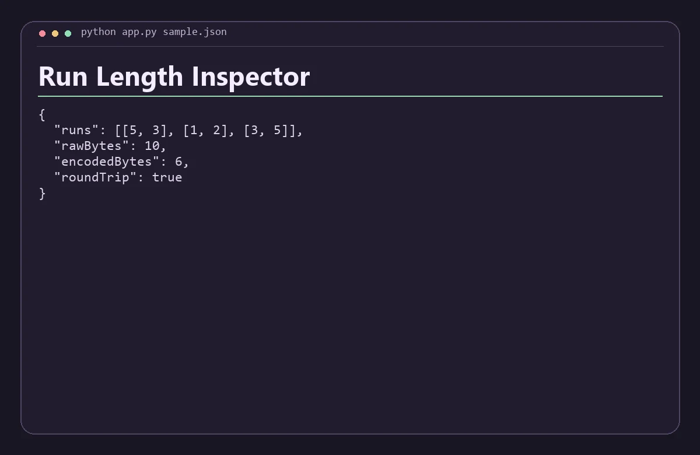

# Run Length Inspector

Inspect runs in symbolic data and compare raw byte counts with a reversible run-length encoding.



## Run

Install Python 3.11 or newer. Run these commands from the repository root.

```sh
python app.py sample.json
```

Replace `sample.json` with a JSON file following the same structure. The app prints a JSON report to standard output.

Supply byte values from 0 to 255. The encoding stores each unsigned byte followed by its 1-byte run count. Runs above 255 are split.

## Verify

Run `python check.py` with Python 3.11 or newer after the build step when applicable. The check verifies the bundled scenario and confirms that an invalid input returns an error.
